# Tooring

Tooring is the theory of computation, animated. Pick a topic, say turning an NFA into a DFA,
give it a machine and a string, and press play. The picture moves one step at a time: the
states that light up, the subset that becomes a new box, the arrow that is drawn to it. Under
the picture a sentence says what that step just did, with the actual states and symbols.

I have taught this course for years, and it has a reputation for being dry. It is not that the
ideas are hard to state. A student can recite the subset construction or the pumping lemma.
What they cannot do is see it happen: which states an NFA is really in after the third symbol,
why the table-filling algorithm marks that pair in round two, what the diagonal machine does
when it is fed its own description. On a whiteboard I draw the start and the end and wave my
hands in between. Tooring draws every step in between, forwards and backwards, on any input
you like.

Live at https://tooring.jyotiprakash.org

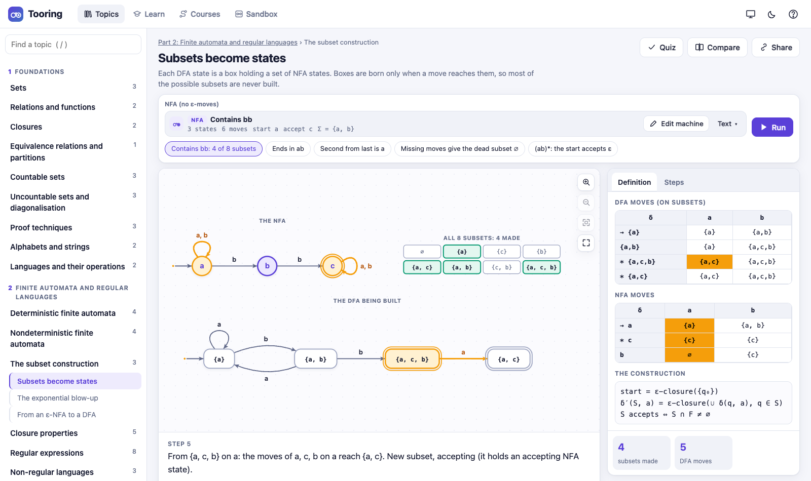

## What it is

Tooring is one HTML file. There is nothing to install and nothing is sent anywhere; your
machines, answers and progress are kept in the browser. Under the page are engines written
for it: finite automata and regular expressions, grammars and their normal forms, LL, LR,
CYK and Earley parsers, pushdown automata, Turing machines with one tape or several,
register and counter machines, recursive functions and the lambda calculus, PCP, SAT and
the reductions between NP-complete problems. Every picture is drawn from what those engines
actually do on your input, so a machine you change is a machine that really runs.

There are 206 topics in 58 families, in seven parts:

- **Foundations** (21 topics): sets, relations and functions, closures, countable and
  uncountable sets, Cantor's diagonal argument, induction, the pigeonhole principle, and
  strings and languages.
- **Finite automata and regular languages** (39): DFAs and NFAs, ε-closures, the subset
  construction, closure properties, regular expressions with Thompson's construction,
  derivatives and state elimination, the pumping lemma, Myhill–Nerode, minimisation,
  decision procedures, and Moore and Mealy machines, two-way automata, string search and
  lexers.
- **Context-free languages** (26): derivations and parse trees, ambiguity, cleaning a
  grammar, Chomsky and Greibach normal forms, pushdown automata and their equivalence with
  grammars, deterministic PDAs, and the context-free pumping lemma and closure.
- **Parsing** (28): recursive descent with backtracking, packrat parsing, FIRST and FOLLOW,
  LL(1) tables and error recovery, shift-reduce, LR(0), SLR(1), LR(1) and LALR(1),
  operator precedence, CYK and Earley, and a small front end from source text to tree.
- **Turing machines and other models** (30): machines that decide, recognise and compute,
  a macro language for building them, many tapes, a two-dimensional tape, nondeterminism,
  enumerators, register and counter machines, linear-bounded automata, unrestricted
  grammars, primitive recursion, the μ operator, Ackermann's function, the lambda calculus,
  encodings, the universal machine and busy beavers.
- **Decidability and computability** (27): the decidable questions about automata and
  grammars, the halting problem, recognisable and co-recognisable languages, mapping and
  Turing reductions, Rice's theorem, undecidable questions about grammars, Post's
  correspondence problem, tilings, Kolmogorov complexity and incompleteness.
- **Complexity** (35): counting steps, P and NP, certificates, co-NP, SAT, DPLL and
  2-SAT, reductions drawn as gadgets (3SAT to CLIQUE, INDEPENDENT SET, VERTEX COVER,
  SUBSET SUM, 3-COLOUR and HAM-PATH), the Cook–Levin tableau, coping with hardness, and
  space: TQBF, Savitch's theorem and reachability in log space.

Each topic has its own picture, made for that idea. An NFA run puts a dot on every state a
branch is in. CYK fills a pyramid of cells from the bottom up. A Turing machine for
palindromes draws the path of its head through time under the tape, so the zig-zag that
costs n² steps is plain to see. The halting problem is a table of programs run on programs,
with the diagonal flipped.

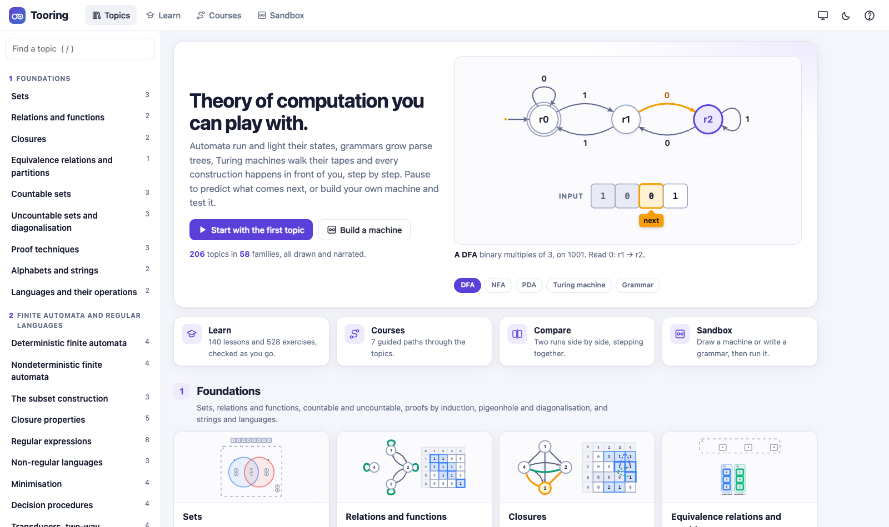

## Watching a topic

The stage is in the middle. Play runs the steps at the speed you set; the arrow keys go one
step forward or back; the timeline jumps anywhere. Under the stage the narration explains the
step: "Round 2: on b, B goes to E and E goes to D. {E, D} is already marked, so {B, E} is too."
On the right is the formal definition, the transition table or the grammar, with the part the
step uses lit, and under it the counters for the topic: symbols read, subsets made, cells
filled, splits tried. The Steps tab lists every step, to jump to any of them.

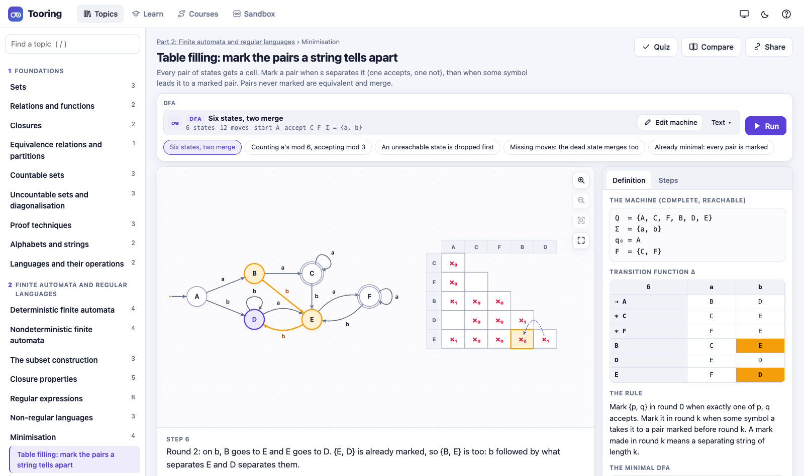

Above the stage you give the input: a machine, a grammar, a regular expression, a formula, a
string. Machines and grammars are shown as a one-line summary that opens into a full editor,
or as text. Each topic has presets for the cases that matter (946 of them across the
catalogue): a string that is rejected, a branch that dies, a grammar that is not in normal
form, a reduction from an unsatisfiable formula, a time bound too short. Bad input is turned
away with a plain message.

![The LR parser at work on x+(x): the LALR(1) automaton with state 3 lit, the stack of states and symbols, and ACTION[3, )] = r3 about to reduce by T → x](docs/images/lr.png)

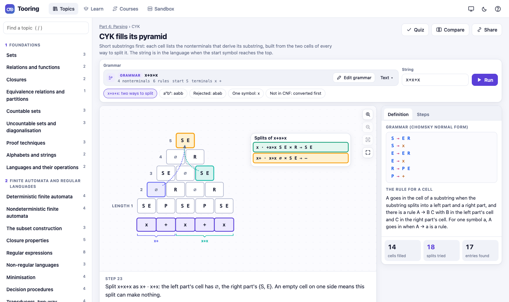

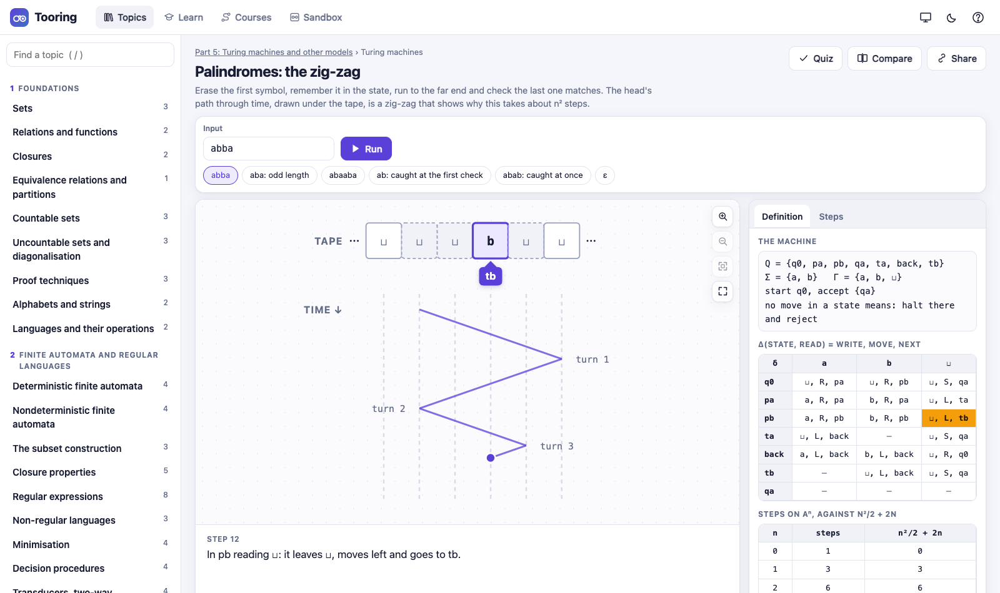

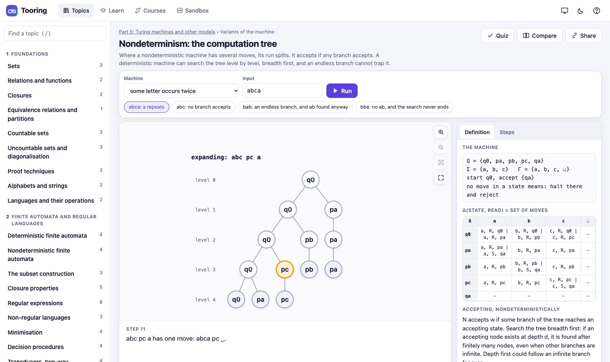

The machines in later parts are drawn the same way. The universal machine shows its three
tapes: the encoded machine, the simulated tape and the state. The halting problem fills its
table one run at a time and then builds the machine D that disagrees with every row.
Reductions are gadgets: a clause becomes a group of vertices, and a satisfying assignment
becomes a clique you can see. The Cook–Levin topics write a computation as a tableau and
then slide a window over it, and if the tableau has been tampered with, the window that
cannot come from any move is caught.

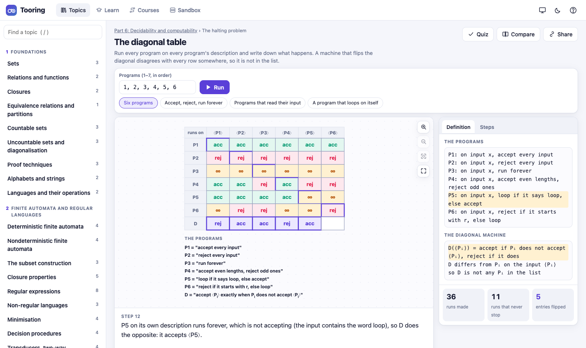

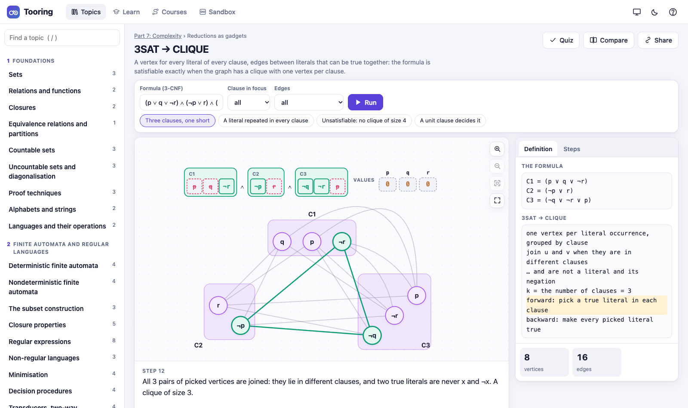

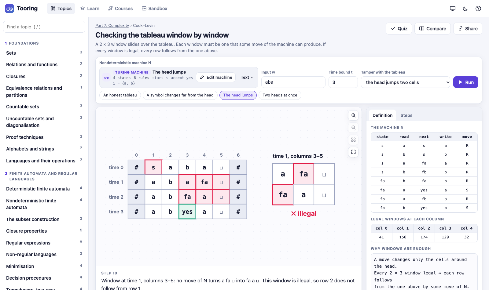

The zoom buttons, a pinch, or Ctrl with the mouse wheel enlarge the picture, with a drag to
look around. Compare runs two inputs, or two topics, side by side with one set of controls:
an accepted string beside a rejected one, or any two topics you choose. Share copies a
link to the topic with the input you gave it.

## Thinking before watching

At the key moments a topic stops and asks. When the table is finished, how many states will
the minimal DFA have? One cell of the CYK pyramid is left: will the start symbol be in it?
Only one domino keeps the two rows agreeing from here: click it. Some questions have options
to choose from; others ask you to click the answer on the picture. You answer, it says whether you were right
and why, and then you watch it happen. Predictions can be turned off with P.

Every topic also has a quiz at the end, 885 questions in all, about the understanding behind
the picture rather than the mechanics of it.

## Building machines and grammars

The **Sandbox** is where students build things of their own. There are nine kinds: a finite
automaton, a PDA, a Turing machine, a grammar, a regular expression, a register machine, a
counter machine, recursive functions and λ-terms. Machines are drawn in a diagram editor:
click to add a state, drag it where you want it, shift-drag from one state to another for a
transition, double-click to rename. Beside the diagram is the same machine as text, and
editing either side updates the other. A Turing machine can also be edited as a table, a row
per state and a column per symbol. Grammars and expressions are typed, coloured as you type,
with the place of a mistake shown.

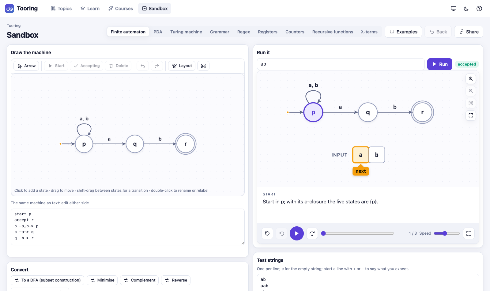

Whatever you build runs on a string step by step, on the same stage as the topics, and can be
tested on a list of strings, each marked with what you expect, so the ones that come out
wrong stand out. It can also be converted: an automaton to a DFA by the subset
construction, minimised, complemented, reversed or turned into a regular expression; an
expression to an NFA by Thompson's construction or to its minimal DFA; a grammar cleaned of
useless symbols and ε-rules, put into Chomsky normal form or turned into a PDA; and a PDA into
a grammar. Back undoes a conversion. What you build is kept in the browser and can be shared
as a link.

## Games

Some ideas are best learned by playing against them. In **the pumping game** you pick a
string, the computer splits it as xyz, and you pick the i that pumps it out of the language;
win every split and you have proved the language is not regular. The context-free pumping
game is the same with five pieces. **Myhill–Nerode** has you colour strings by what every
suffix does to them, until aⁿbⁿ needs a new colour for ever. **Fool the decider** lets you
choose a strategy for a halting decider and watch the diagonal machine catch it out. The
domino puzzle of PCP, the tiling puzzle, and TQBF as a game between ∃ and ∀ are played the
same way.

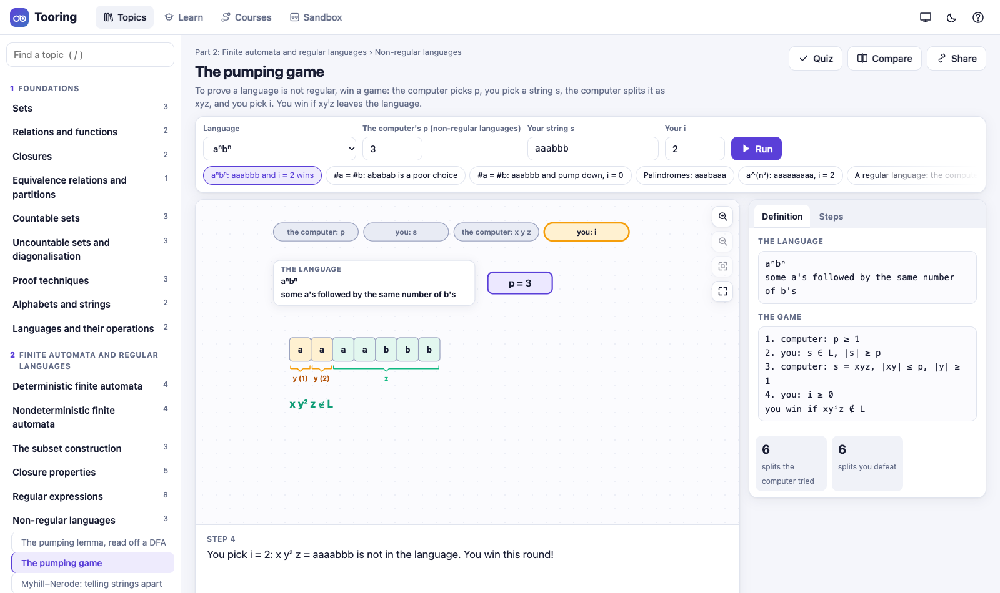

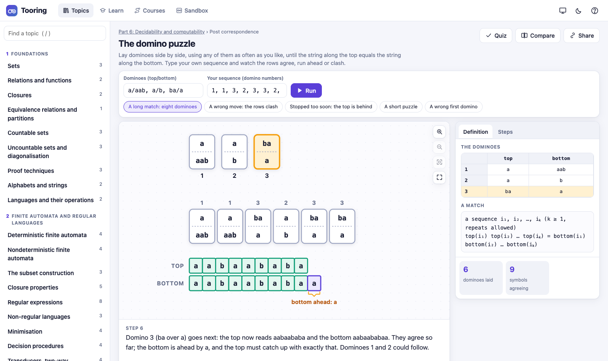

## Lessons, exercises, tours and courses

There are 140 lessons in 40 chapters. A lesson explains one
idea and has the topic running inside it, with questions to answer before reading on,
machines to run, and editors with strings to test.

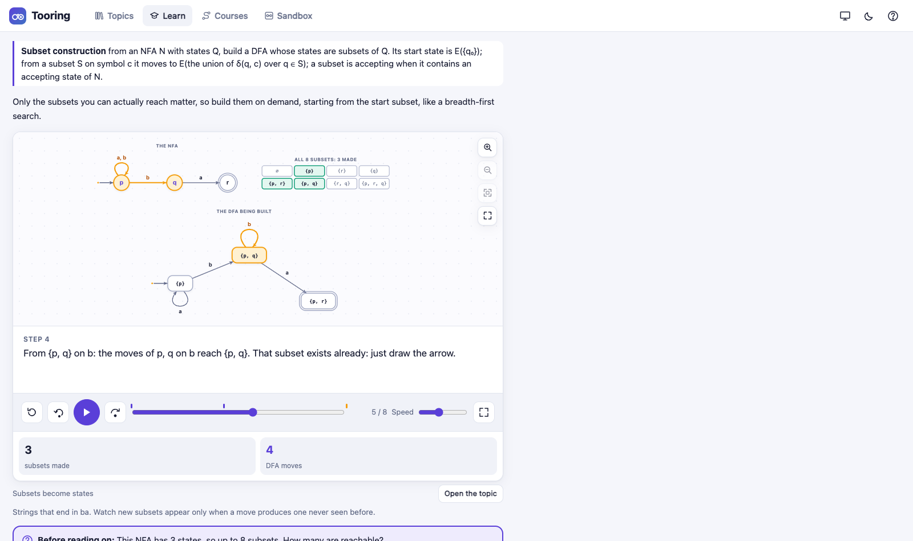

There are 528 exercises: machines, grammars and expressions to build, tables to fill in (FIRST
and FOLLOW sets, LL(1) tables, the CYK triangle), strings and numbers to work out, pumping
arguments, and questions to choose an answer to. An answer is checked, not compared as text.
A finite automaton or an expression is checked for equivalence with the language, exactly,
and if it is wrong the checker gives the shortest string it gets wrong, with a button to run
your machine on that string and see where it goes astray. PDAs, Turing machines and grammars
are run on every string up to a length. Each exercise has three hints, the last one the
worked answer.

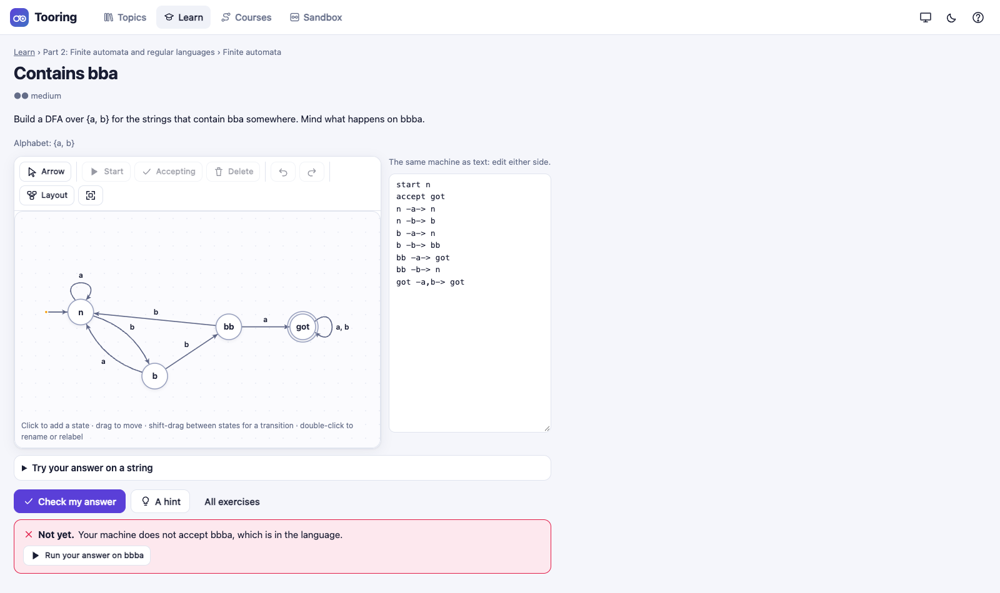

The seven **tours** walk through a part from beginning to end, pointing at one thing at a
time, for a first look round. The seven **courses** put the topics, lessons and exercises of
a part in an order that builds up, with a line on what to look for in each, and keep your
progress.

## Phone, projector and themes

There is a light and a dark theme, and the first visit follows the system setting. Projector
mode (Shift+P) makes the type larger and the lines heavier, for a classroom wall. On a phone
the stage comes first with the narration under it, the inputs follow, and the definition and
the steps open in a drawer from the bottom.

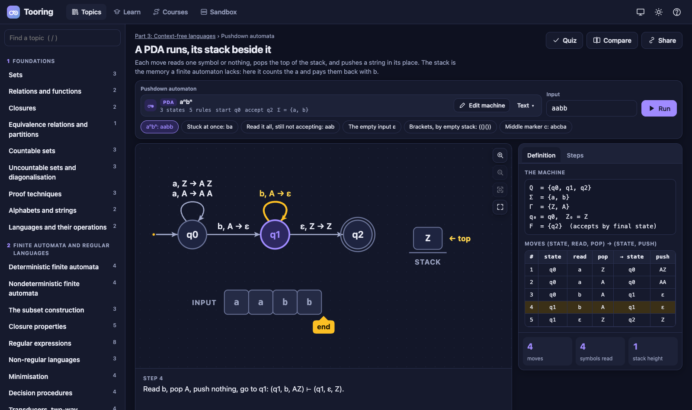

<p>
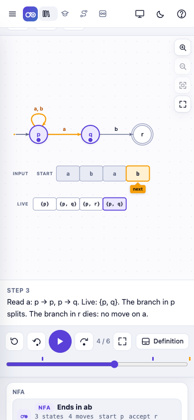
</p>

## Keyboard

| Key | Does |
| --- | --- |
| Space | play or pause |
| → ← | next step, step back |
| Home, End | first or last step |
| [ ] | slower, faster |
| F, Shift+F | fit the picture, the stage on the whole screen |
| + − | zoom in, out |
| P, Q | predictions on or off, the quiz |
| / | find a topic |
| T, Shift+P | light or dark, projector mode |
| ? | the list of keys |

## Running it locally

Tooring is the single file `index.html`. Open it from any web server:

```
python3 -m http.server 8000
```

and go to http://localhost:8000. To change it, edit the files under `src` and run

```
node build.mjs
```

which joins the sources listed in `src/manifest.json` into `index.html`. While working,
`node tools/devpage.mjs 8080` serves http://127.0.0.1:8080/dev.html, the same page with every
source file loaded on its own, so a change needs no build.

## Testing

The engines are tested on their own in Node: `node tests/fa.mjs`, and likewise `regex`,
`grammar`, `parsers`, `pda`, `tm`, `models` and `complexity`. Many of the checks compare an
engine with a brute-force oracle on seeded random machines, grammars and formulas: a
minimised DFA must accept the same strings as the original, a SAT solver must agree with
trying every assignment.

`node tools/check-topics.mjs` runs every topic with its default input and with every preset,
and checks that every frame draws, that the steps are narrated, that the predictions can be
answered, and that the topic has a quiz. `node tools/check-content.mjs` checks every
exercise (its solution passes its own checker and every one of its wrong answers fails) and
every lesson, tour and course step.

`node tools/check-diagrams.mjs` draws every topic at its first, last and two middle frames,
with every preset, in the built page at desktop and phone sizes, and reports shapes that
overlap, edges that run through labels, text cut off by its box, and pages wider than the
screen. `node tests/e2e/run.mjs` runs the end to end tests in headless Chrome: the shell and
routes, the player, the editors, the sandbox, the lessons and exercises, and phone-sized
screens. `node tools/readme-shots.mjs` makes the pictures in this file.

## Project layout

```
src/core      the engines: automata, regular expressions, grammars, parsers, PDAs, Turing machines,
              the other models, computability, PCP, SAT, reductions and Cook–Levin
src/stage     the stage that draws and animates a frame, and the drawing kits (tapes, stacks, trees,
              tables, dominoes, gadgets ...)
src/topics    the topics, a file per family: inputs, presets, frames, narration, predictions and quiz
src/content   the lessons, exercises, tours and courses, a file per part
src/app       the page: catalogue, player, editors, sandbox, lessons, Compare, courses, checkers, styles
tests         the engine tests, and the end to end tests in tests/e2e
tools         the Chrome driver, the topic, content and diagram checkers, timing, screenshots
```

## License

Tooring is free software under the GNU General Public License, version 3 or later. See
`LICENSE` for the full text and `COPYRIGHT` for the notice.

Under section 7 of the license there are additional terms, written out in full in `NOTICE`.
Any copy, modification or derived work, including a hosted version, must keep the attribution
"Based on Tooring by Jyotiprakash Mishra (https://tooring.jyotiprakash.org)" in its source and
show it in its about screen or other legal notices. This applies to the program, the topics
with their narration and quizzes, the lessons, exercises and tours, and screenshots or
recordings of the animations used as teaching material. A modified version must be marked as
changed and must not be presented as the original Tooring.

Copyright (C) 2026 Jyotiprakash Mishra
